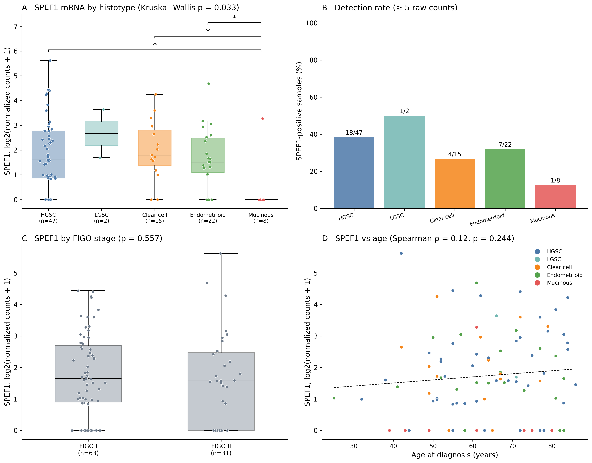
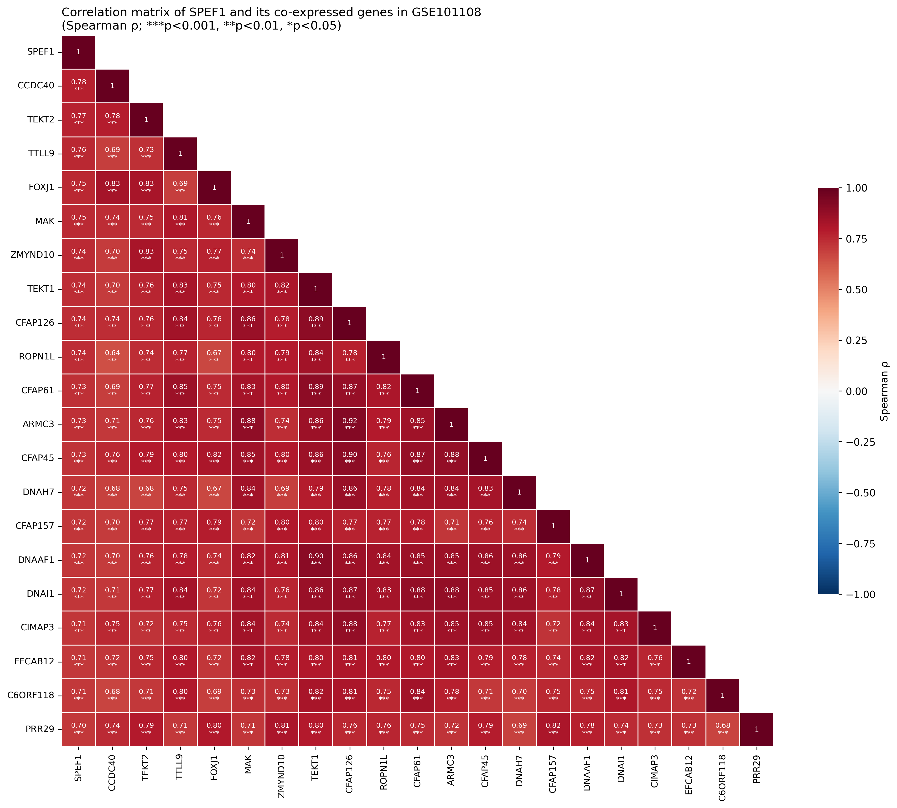
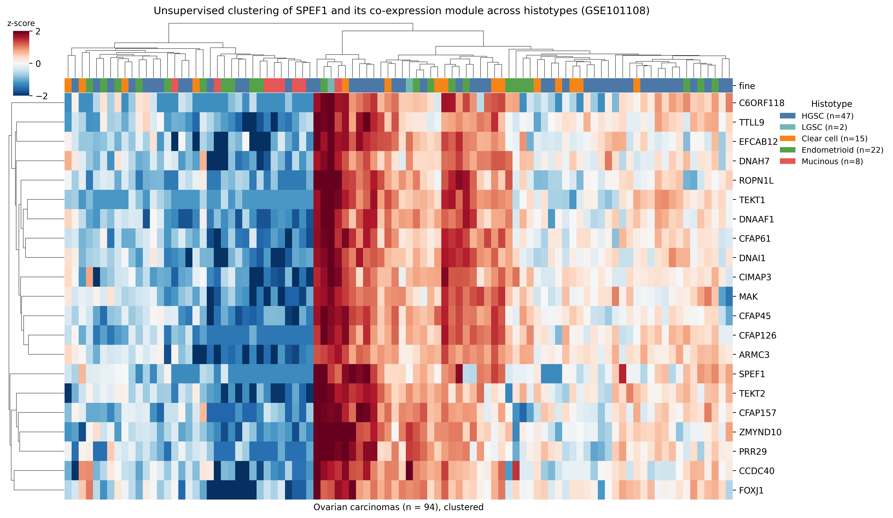

# SPEF1 in ovarian cancer — GSE101108 analysis pipeline

Code for the transcriptomic (dataset) results of the study
**"Expression of SPEF1 in Primary Ovarian Cancer"**.

## About the study

SPEF1 (sperm flagellar 1) is a calponin-homology, microtubule-binding protein of
motile cilia and flagella. It is enriched in testis but also in other tissues
bearing motile cilia, such as the fallopian tube, and, unlike its homologue SPEF2,
it is not catalogued in the CT database; the paper therefore treats it as a marker
of ciliated-lineage differentiation rather than as a classical cancer–testis
antigen. SPEF1 is characterized in primary ovarian carcinoma by combining three
complementary lines of evidence:

- **Immunohistochemistry** on a tissue microarray of primary ovarian carcinomas,
  metastases and normal ovary, scored semi-quantitatively.
- **Bioinformatic analysis** of the SPEF1 protein–protein interaction network and
  its functional (Gene Ontology) enrichment (STRING), and exploratory, univariate
  survival associations (KM-plotter).
- **Independent validation** in a histotype-annotated RNA-sequencing cohort,
  **GSE101108** (94 early-stage primary invasive ovarian carcinomas spanning all
  major histotypes), which is what this repository processes.

This repository contains **source code only**. No patient or dataset files are
distributed: GSE101108 is downloaded from GEO at run time and the reference data
are recreated locally.

## Highlights

- SPEF1 protein is **absent from normal ovary** but expressed in primary ovarian
  carcinomas on the tissue microarray (low-grade serous 7/8, mucinous 7/10, clear
  cell 3/5, high-grade serous 28/53, endometrioid 1/3); positivity is significantly
  higher than in normal ovary for the high-grade serous, low-grade serous and
  mucinous histotypes (Fisher exact, BH-corrected), while the clear cell and
  endometrioid groups are too small for a conclusive comparison. Metastases,
  analysed as a separate group, are positive in 6/10.
- In the independent GSE101108 cohort, SPEF1 mRNA is detected in **33% of
  carcinomas** and is **virtually absent in the mucinous histotype**, with no
  significant association with FIGO stage or age.
- The 304-gene SPEF1 co-expression module is dominated by **motile-cilium /
  axoneme** genes — SPEF1 marks a ciliary transcriptional programme. The STRING
  network provides biological context for this, not independent validation.
- SPEF1 is inversely correlated with **CD274, PDCD1LG2 and HAVCR2**; its inverse
  correlations with marker-based immune-cell signatures are weak and do not survive
  multiple-testing correction, i.e. **lower immune-related transcriptional
  signatures**, not a measured difference in infiltration.
- Survival associations from KM-plotter are **exploratory, univariate and
  heterogeneous** across datasets and subgroups (17 of 68 subgroup estimates
  survive BH correction).

## Selected results

<table>
<tr>
<td align="center" width="33%"></td>
<td align="center" width="33%"></td>
<td align="center" width="33%"></td>
</tr>
<tr>
<td align="center"><em>SPEF1 mRNA by histotype and clinical associations (HGSC/LGSC split)</em></td>
<td align="center"><em>Correlation matrix of the SPEF1 co-expression module</em></td>
<td align="center"><em>Unsupervised clustering of SPEF1 and its co-expressed genes</em></td>
</tr>
</table>

*Figures generated by the scripts in this repository from GSE101108.*

## What it reproduces

| Manuscript item | Script |
|---|---|
| Fig. 3 — SPEF1 mRNA by histotype and clinical associations (HGSC/LGSC split), Table 2 (cohort characteristics), Table 6 (TMA, semi-quantitative) | `SPEF1_analysis/regen_histotype_tables.py` |
| Fig. 4 — SPEF1 co-expression correlation matrix (significance stars) | `SPEF1_analysis/regen_coexpression_figures.py` |
| Fig. 5 — unsupervised clustering heatmap (SPEF1 + 20 co-expressed genes) | `SPEF1_analysis/regen_coexpression_figures.py` |
| Fig. 6 — differential expression (volcano) | `SPEF1_analysis/main.py` |
| Fig. 7 — GO enrichment of the co-expression module (STRING style) | `SPEF1_analysis/regen_dataset_go.py` |
| Fig. 8 — association with immune-related transcriptional signatures | `SPEF1_analysis/main.py` |
| Table 3 — SPEF1 detection by histotype, Table 4 — top GO terms, results workbook | `SPEF1_analysis/main.py` |
| Detection-threshold rationale, co-expression of the 20 STRING interactors of Table 1, SPEF2/MUC2/CDX2 by histotype | `SPEF1_analysis/main.py` |
| Table 5 — Benjamini–Hochberg correction of the KM-plotter subgroup estimates (†) | `SPEF1_analysis/kmplotter_multiplicity.py` |

Not generated by this code:

- **Figs 1–2 and Table 1 (STRING)** — the SPEF1 protein–protein interaction network
  and its GO enrichment were exported directly from the string-db.org web interface
  (SPEF1-centered query, *Homo sapiens*), and Table 1 lists the node degrees of that
  network.
- **Figs 9–10** are representative immunohistochemistry images. The hazard ratios
  of **Table 5** come from the external KM-plotter web tool (probe 216119_s_at,
  median split); they are stored as reported in
  `SPEF1_analysis/external/kmplotter_table5.csv`, and only their multiple-testing
  correction is computed here.

## Changes after peer review

The repository was updated to match the revised, accepted manuscript:

- **Tissue microarray (Table 6).** Metastases are now one separate group of 10
  (lymph node 7, pelvic cavity 2, greater omentum 1; 9 serous, 1 clear cell)
  instead of 9 "lymph-node metastases": the metastatic clear cell carcinoma had
  been matched by the keyword "clear cell" and pooled with the primary clear cell
  carcinomas. The high-grade serous core without tissue is excluded (n = 53). The
  BH family is the 15 pairwise comparisons of the five primary histotypes and
  normal ovary; metastases are compared with all primary carcinomas separately.
- **Detection threshold.** `threshold_rationale` reports, for 1, 3, 5 and 10 reads,
  the counts per million across libraries, the Poisson probability of reaching the
  threshold by sampling noise, and the AUC of the ciliated-programme score between
  positive and negative tumours (0.82–0.94 at every threshold).
- **STRING interactors.** Co-expression is now reported for the 20 interactors of
  Table 1 (13 pass the expression filter, 6 are co-expressed at q < 0.05), using the
  transcriptome-wide q-values; the earlier 11-gene GeneMANIA list was removed.
- **Reported counts.** The numbers file separates the 1,056 genes correlated with
  SPEF1 (667 positive, 389 negative) from the 304-gene co-expression module (300
  tested in GO), and the 472 genes at q < 0.05 from the 266 differentially expressed
  genes (|log2FC| ≥ 1; 243 up, 23 down). Nominal p and BH q are written for every
  immune signature and checkpoint gene.
- **Table 5.** Post hoc BH correction across the 68 KM-plotter subgroup estimates;
  the stage I+II OS hazard ratio reads 0.42 (95% CI 0.20–0.89), as corrected in the
  revision.

## Repository layout — two stages

```
GSE101108_pipeline/   Stage 1 — download, metadata normalization, histotype
                      classification, expression-matrix assembly
SPEF1_analysis/       Stage 2 — SPEF1 co-expression, differential expression,
                      GO over-representation, immune signatures, figures/tables
run_all.py            End-to-end driver (stage 1 -> stage 2 -> figure scripts)
```

The work is split into two packages on purpose:

- **`GSE101108_pipeline/` — data engineering (gene-agnostic).** It turns the public
  GEO series into a clean, analysis-ready dataset: it downloads GSE101108, normalizes
  the sample metadata, classifies the histotypes with explicit, auditable rules, maps
  gene identifiers to symbols, and assembles the expression matrices. This step is
  slow (network, one-off) and independent of SPEF1 — the same prepared cohort could
  drive any downstream analysis.
- **`SPEF1_analysis/` — the science (SPEF1-specific).** It consumes Stage 1's
  expression matrices and produces the actual results of the paper: SPEF1 co-expression,
  differential expression, GO over-representation, immune-signature association, and the
  manuscript figures and tables. This step is fast and re-run many times.

Keeping them apart means each has its own `config.py`, `main.py`, `src/` modules and
`tests/`, the heavy download is decoupled from the analysis you iterate on, and the
data-preparation stage stays reusable.

## Requirements

Python 3.10+ and the packages in `requirements.txt`:

```bash
pip install -r requirements.txt
```

## Running

From the repository root:

```bash
python run_all.py                 # full reproduction
python run_all.py --skip-download # reuse a previous GEO download
python run_all.py --skip-tma      # skip the tissue-microarray table (Table 6)
```

Or one stage at a time:

```bash
python GSE101108_pipeline/main.py                  # download + prepare the cohort
python SPEF1_analysis/main.py                      # core analysis + volcano/immune + workbook
python SPEF1_analysis/regen_histotype_tables.py    # Fig 3 + Table 2 (+ Table 6 if TMA present)
python SPEF1_analysis/regen_coexpression_figures.py  # Fig 4 correlation matrix + Fig 5 heatmap
python SPEF1_analysis/regen_dataset_go.py          # Fig 7 dataset GO (STRING style)
python SPEF1_analysis/kmplotter_multiplicity.py    # Table 5 BH correction (no download needed)
```

Outputs are written under `SPEF1_analysis/results/` (figures as 300-dpi PNG and
LZW-compressed TIFF; tables as CSV and multi-sheet Excel).

## Data notes

- **GSE101108** is fetched from NCBI GEO on the first run and cached under
  `GSE101108_pipeline/data/` (git-ignored). Raw counts are annotated on hg19.
- **GO annotations** come from NCBI `gene2go`, filtered to human in streaming mode,
  so no external enrichment server is required.
- **Tissue-microarray scores** (Table 6) are the paper's immunohistochemistry raw
  data and are *not* included. To regenerate Table 6, place the Excel file at
  `data/TMA_SPEF1_expression.xlsx`; without it, `regen_histotype_tables.py` still
  writes Fig 3 and Table 2 and simply skips Table 6.
- **Immune signatures** are marker-based scores: each marker's log2(median-of-ratios
  + 1) value is z-scored across the 94 tumours and the markers are averaged. No
  background correction is applied (it has no counterpart for read counts), and they
  are not a deconvolution of the infiltrate. MRC1 and PIFO are not retrieved in the
  annotated matrix; the `firme_composizione` sheet lists the markers actually used.

## Reproducibility

- Counts are normalized with the median-of-ratios method (DESeq2-style).
- All hypothesis tests are non-parametric (Mann–Whitney, Kruskal–Wallis, Fisher
  exact, Spearman), with Benjamini–Hochberg FDR control; effect sizes are Cliff's
  delta. The values quoted in the manuscript are written to
  `SPEF1_analysis/results/tables/manuscript_numbers.json` — none are typed by hand.
- Unit tests:

```bash
python -m pytest GSE101108_pipeline/tests -v
python -m pytest SPEF1_analysis/tests -v
```

## License

MIT — see [LICENSE](LICENSE).
